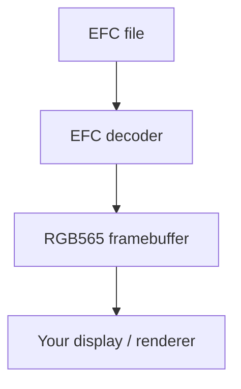
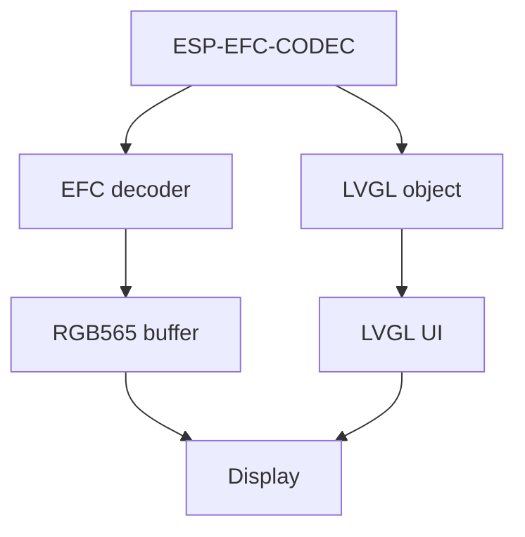

# ESP-EFC-CODEC — Efficient PC Encoder and On-Device Decoder for Emote Animations

- [](https://components.espressif.com/components/espressif/esp_efc_codec)
- [中文版](./README_CN.md)

## Fast, compact animations for ESP32 and LVGL

**ESP-EFC-CODEC brings EFC animation decoding to ESP32, with both a low-level decoder and a ready-to-use LVGL object.**

EFC is designed for **short looping animations such as eyes, faces, reactions, and UI effects**. It uses block-based decoding and inter-frame reuse to reduce both flash usage and CPU work.

You can use it at two levels:

|                 | Use                                                                                    |
| --------------- | -------------------------------------------------------------------------------------- |
| **EFC decoder** | Decode directly into an RGB565 framebuffer for custom display pipelines                |
| **LVGL object** | Drop an EFC animation directly into an LVGL UI without implementing the playback logic |

### Why EFC?

Compared with GIF and EAF, EFC targets the specific characteristics of embedded animations:

* **Small files** — especially effective when only a small part of each frame changes
* **Fast decoding** — unchanged blocks can be skipped
* **Low RAM overhead** — one framebuffer can be reused for the entire animation
* **Direct RGB565 output** — suitable for embedded displays
* **Lossless** — decoded pixels are identical to the encoded RGB565 pixels
* **LVGL-ready** — use the supplied LVGL object when a custom decoder is not needed

Results for 23 eye-emote clips from the [Emote Pack](https://dl.espressif.com/AE/Emote%20Pack.zip), tested on ESP32-S3:

| Format            | Stored size |       Decode time |      Throughput |
| ----------------- | ----------: | ----------------: | --------------: |
| GIF               |     3.46 MB |                 — |               — |
| EAF RLE           |    12.85 MB |     77.9 ms/frame |      6.6 Mpix/s |
| EAF RLE + Huffman |     8.50 MB |     81.9 ms/frame |      6.2 Mpix/s |
| **EFC**           | **1.94 MB** | **25.7 ms/frame** | **19.9 Mpix/s** |
| **EFC + zlib**    | **0.65 MB** | **25.8 ms/frame** | **19.8 Mpix/s** |

So for this workload, EFC is both **smaller than the source GIFs and substantially faster to decode than EAF**.

---

## Two ways to use EFC

### 1. Direct EFC decoder

For applications with their own display or rendering pipeline, use the decoder API directly.



The decoder keeps the framebuffer between frames. Unchanged blocks are left untouched, so they do not need to be decoded again. A clip with a GIF-style color key can be decoded with `esp_efc_dec_frame_with_alpha()` into RGB565 plus one alpha byte per pixel (`0x00` on the key color, `0xFF` elsewhere). `esp_efc_dec_frame()` still writes opaque RGB565 and skips the key.

```c
#include "esp_efc_codec.h"

void play_emote(const uint8_t *blob, size_t len, uint16_t *fb)
{
    esp_efc_dec_handle_t dec = NULL;
    if (esp_efc_dec_open(blob, len, &dec) != ESP_EFC_OK) {
        return;
    }

    esp_efc_dec_info_t info = { 0 };
    if (esp_efc_dec_get_info(dec, &info) != ESP_EFC_OK) {
        esp_efc_dec_close(dec);
        return;
    }

    for (;;) {
        for (int i = 0; i < info.frame_count; i++) {
            if (esp_efc_dec_frame(dec, i, fb) != ESP_EFC_OK) {
                break;
            }

            lcd_draw_rgb565(fb, info.width, info.height);
        }
    }

    esp_efc_dec_close(dec);
}
```

`fb` is a `width × height` RGB565 framebuffer.

**Important:** do not clear `fb` between frames. Unchanged blocks intentionally remain from the previous frame.

---

### 2. LVGL object

If your application already uses LVGL, you can skip the playback implementation and embed an EFC animation directly as an LVGL object.



The LVGL integration handles the animation playback inside the object, making EFC suitable for applications where an animation is simply another UI element. When the file carries a color key, the object draws RGB565A8 and that color is transparent. A file with no key stays opaque RGB565.

#### Scaling quality and performance

For the best image quality and playback performance, resize the source GIF on the PC to the intended display size before encoding it as EFC. If an application uses several display sizes, generate a separate EFC asset for each size.

The LVGL object can fit an oversized animation into its available area, but software scaling uses fast nearest-neighbor downscaling. It preserves the aspect ratio and does not upscale. A large reduction can therefore produce jagged or soft-looking edges, especially around transparency, while decoding still processes the original full-resolution frame. Runtime scaling is convenient when the display size is not known in advance, but pre-scaling the GIF avoids this quality limitation and reduces decoder and scaling work.
```c
#include "lv_efc.h"

lv_obj_t *emote = lv_efc_create(parent);

/* Copies the raw file bytes. A path also works: lv_efc_set_src(emote, "/sdcard/smile.efc") */
lv_efc_set_src_data(emote, efc_data, efc_size);
lv_efc_play(emote);
```

`lv_efc_set_src()` takes one source: a POSIX path, an LVGL filesystem path, or an `lv_image_dsc_t`. It does not take a pointer plus a length. Use `lv_efc_set_src_data()` for a memory blob. `lv_efc_play()` restarts at frame 0. `lv_efc_pause()` holds the current frame, and `lv_efc_resume()` continues.

This makes an EFC animation usable like other LVGL UI objects instead of requiring the application to manage:

* frame timing
* frame iteration
* framebuffer updates
* invalidation / redraw
* animation playback state

### When to use which?

| Application                     | Recommended API |
| ------------------------------- | --------------- |
| Custom LCD/display driver       | **EFC decoder** |
| Custom rendering pipeline       | **EFC decoder** |
| Non-LVGL application            | **EFC decoder** |
| LVGL application                | **LVGL object** |
| Animation as part of an LVGL UI | **LVGL object** |
| Need full control over decoding | **EFC decoder** |

The important distinction is simple:

> **Use the decoder when you control the rendering pipeline. Use the LVGL object when you just want an animation in your LVGL UI.**

---

## How EFC works

EFC is optimized around a common property of animated faces and UI graphics:

**most of the image often stays unchanged between frames.**

Instead of rebuilding the complete image every frame, EFC divides the image into blocks.

```text
Frame N
┌────┬────┬────┬────┐
│    │    │    │    │
├────┼────┼────┼────┤
│    │ ██ │ ██ │    │
├────┼────┼────┼────┤
│    │    │    │    │
└────┴────┴────┴────┘

Frame N+1
┌────┬────┬────┬────┐
│    │    │    │    │
├────┼────┼────┼────┤
│    │ ██ │    │    │
├────┼────┼────┼────┤
│    │    │    │    │
└────┴────┴────┴────┘

Only changed blocks need to be decoded.
```

This provides two benefits at once:

**less data stored + less work performed during playback.**

### Core properties

* **Block decoding** — frames are processed in small blocks
* **Inter-frame reuse** — unchanged blocks reuse the previous framebuffer contents
* **In-place decoding** — no second full-frame buffer is required
* **RGB565 output** — directly suitable for embedded displays
* **Lossless** — no image quality loss
* **Optimized fill/copy paths** — ESP32-S3 and ESP32-P4 use optimized implementations

---

## Performance

Measurements were taken on **ESP32-S3**.

Each file was played once (`iters=1`). Mean frame time is weighted by frame count.

Every retained clip was decoded four times and matched the expected pixels.

### Eye emulation — 23 clips

This is the workload EFC is primarily optimized for: few colors, large unchanged regions, and relatively small changes between frames.

|            |     GIF |    EAF RLE | EAF RLE + Huff |         **EFC** |  **EFC + zlib** |
| ---------- | ------: | ---------: | -------------: | --------------: | --------------: |
| Stored     | 3.46 MB |   12.85 MB |        8.50 MB |     **1.94 MB** |     **0.65 MB** |
| vs GIF     |      1× |       3.7× |           2.5× |       **0.56×** |       **0.19×** |
| Decode     |       — |  77.9 ms/f |      81.9 ms/f |   **25.7 ms/f** |   **25.8 ms/f** |
| Throughput |       — | 6.6 Mpix/s |     6.2 Mpix/s | **19.9 Mpix/s** | **19.8 Mpix/s** |
| vs EAF RLE |       — |         1× |          0.95× |       **3.03×** |       **3.02×** |

GIF decode time was not measured in this benchmark; the GIF column is provided for source-file size comparison.

zlib reduces the EFC set from **1.94 MB to 0.65 MB** while adding almost no decode cost for this workload.

### Real GIFs — 28 clips

Real-world GIFs generally have more colors and more frame-to-frame movement, reducing the benefit of inter-frame reuse.

|            |     GIF |    EAF RLE | EAF RLE + Huff |        **EFC** | **EFC + zlib** |
| ---------- | ------: | ---------: | -------------: | -------------: | -------------: |
| Stored     | 39.8 MB |    58.8 MB |        47.9 MB |    **22.6 MB** |    **17.4 MB** |
| vs GIF     |      1× |       1.5× |           1.2× |      **0.57×** |      **0.44×** |
| Decode     |       — |  29.3 ms/f |      55.8 ms/f |  **18.4 ms/f** |      24.8 ms/f |
| Throughput |       — | 4.6 Mpix/s |     2.4 Mpix/s | **7.3 Mpix/s** |     5.4 Mpix/s |
| vs EAF RLE |       — |         1× |          0.52× |      **1.59×** |          1.18× |

The more an animation changes between frames, the less EFC can exploit unchanged blocks.

---

## When EFC is a good fit

Use EFC when you have:

* Short looping animations
* RGB565 displays
* Limited RAM
* Flash-sensitive applications
* Animations with relatively large unchanged regions
* LVGL-based UI that needs lightweight animated objects

EFC is not intended to replace GIF as a general-purpose interchange format. It is optimized for **embedded playback**, where flash size, decode time, RAM usage, and simple integration all matter.

---

## Typical applications

EFC is particularly suitable for:

* **animated badges**
* Desk pets and companion robots
* Voice-assistant faces
* Smart-speaker animations
* Round watches
* Small LVGL displays
* Animated UI feedback
* Loading / success / error animations
* Eye and facial-expression animations
* Retail and appliance UI effects

---

## Convert GIF to EFC

The encoder is PC-only. This release includes the standalone browser and
Node.js tools under `pc/js/dist`.

Recommended settings for the ESP32 decoder:

* **Tile:** `4`
* **zlib:** enabled

### Browser

Open:

```text
pc/js/dist/encode.html
```

The page is self-contained. No network connection or local server is required.

1. Select a GIF.
2. Leave **Tile** at `4 (device decoder)`.
3. Leave **zlib** enabled.
4. Click **Encode**.
5. Click **Download**.

The page shows the GIF size, EFC size, frame count, and encoding time.

### Node.js

Node.js 18 or later:

```bash
cd pc/js/dist
node encode_gif.mjs smile.gif smile.efc
```

The released script includes its dependencies; `npm install` is not required.

Disable zlib with:

```bash
node encode_gif.mjs smile.gif smile.efc raw
```

Encode multiple GIFs:

```bash
mkdir -p out

for g in *.gif; do
    node encode_gif.mjs "$g" "out/${g%.gif}.efc"
done
```

---

## LVGL Examples

Refer [emote_player](examples/emote_player/) for details integration of `esp_efc_codec` to your LVGL project.


---

## Technical Support and Feedback

* Technical questions: [esp32.com forum](https://esp32.com/viewforum.php?f=20)
* Bugs and feature requests: open an issue in the `esp_efc_codec` project
