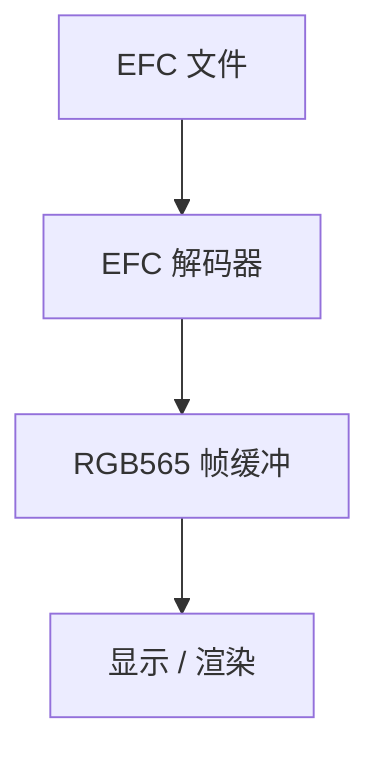
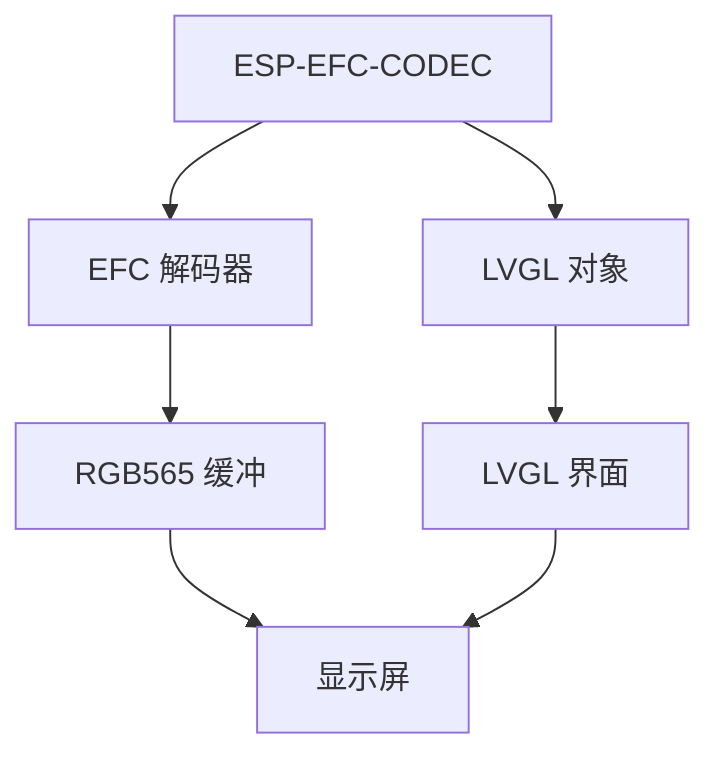

# ESP-EFC-CODEC — 面向表情动画的高效 PC 端编码器与设备端解码器

- [](https://components.espressif.com/components/espressif/esp_efc_codec)
- [English](./README.md)

## 面向 ESP32 与 LVGL 的快速、紧凑动画

**ESP-EFC-CODEC 为 ESP32 提供 EFC 动画解码，包含底层解码器和可直接使用的 LVGL 对象。**

EFC 面向**短循环动画**，例如眼睛、表情、反应和界面动效。它按块解码，并复用帧间未变化的区域，从而同时减少 Flash 占用和 CPU 工作量。

可以在两个层次上使用：

|                 | 用途                                                         |
| --------------- | ------------------------------------------------------------ |
| **EFC 解码器**  | 直接解码到 RGB565 帧缓冲，接入自定义显示流程                 |
| **LVGL 对象**   | 把 EFC 动画放进 LVGL 界面，无需自行实现播放逻辑              |

### 为什么用 EFC？

相对 GIF 和 EAF，EFC 针对嵌入式动画的特点：

* **文件小** — 每帧只有一小部分变化时尤其有效
* **解码快** — 未变化的块可以跳过
* **RAM 开销低** — 整段动画可以复用同一块帧缓冲
* **直接输出 RGB565** — 适合嵌入式屏幕
* **无损** — 解码像素与编码时的 RGB565 像素一致
* **可直接用于 LVGL** — 不需要自定义解码器时，使用随组件提供的 LVGL 对象

以下结果基于 [Emote Pack](https://dl.espressif.com/AE/Emote%20Pack.zip) 中的 23 个眼睛表情动画片段，并在 ESP32-S3 上测试：

| 格式              |    存储大小 |           解码时间 |          吞吐 |
| ----------------- | ----------: | -----------------: | ------------: |
| GIF               |     3.46 MB |                  — |             — |
| EAF RLE           |    12.85 MB |     77.9 ms/帧     |    6.6 Mpix/s |
| EAF RLE + Huffman |     8.50 MB |     81.9 ms/帧     |    6.2 Mpix/s |
| **EFC**           | **1.94 MB** | **25.7 ms/帧**     | **19.9 Mpix/s** |
| **EFC + zlib**    | **0.65 MB** | **25.8 ms/帧**     | **19.8 Mpix/s** |

在这组素材上，EFC **比源 GIF 更小，解码也明显快于 EAF**。

---

## 两种用法

### 1. 直接使用 EFC 解码器

应用已有自己的显示或渲染流程时，直接调用解码器 API。



解码器在帧与帧之间保留帧缓冲。未变化的块保持原样，不必再次解码。带有 GIF 风格色键的片段可以用 `esp_efc_dec_frame_with_alpha()` 解成 RGB565 再加每像素一个 alpha 字节（键色为 `0x00`，其余为 `0xFF`）。`esp_efc_dec_frame()` 仍写出不透明的 RGB565，并跳过色键。

```c
#include "esp_efc_codec.h"

void play_emote(const uint8_t *blob, size_t len, uint16_t *fb)
{
    esp_efc_dec_handle_t dec = NULL;
    if (esp_efc_dec_open(blob, len, &dec) != ESP_EFC_OK) {
        return;
    }

    esp_efc_dec_info_t info = { 0 };
    if (esp_efc_dec_get_info(dec, &info) != ESP_EFC_OK) {
        esp_efc_dec_close(dec);
        return;
    }

    for (;;) {
        for (int i = 0; i < info.frame_count; i++) {
            if (esp_efc_dec_frame(dec, i, fb) != ESP_EFC_OK) {
                break;
            }

            lcd_draw_rgb565(fb, info.width, info.height);
        }
    }

    esp_efc_dec_close(dec);
}
```

`fb` 是一块 `宽 × 高` 的 RGB565 帧缓冲。

**注意：** 帧与帧之间不要清空 `fb`。未变化的块故意保留上一帧的内容。

---

### 2. LVGL 对象

应用已经使用 LVGL 时，可以不再自己实现播放，把 EFC 动画直接作为 LVGL 对象放进界面。



LVGL 集成在对象内部完成动画播放，动画就是界面里的一个元素。文件带色键时，对象按 RGB565A8 绘制，该颜色透明。没有色键的文件保持不透明 RGB565。

#### 缩放质量与性能

为了获得最佳画质和播放性能，建议先在 PC 上把源 GIF 缩放到实际显示尺寸，再编码为 EFC。如果应用需要多种显示尺寸，请为每种尺寸分别生成 EFC 资源。

LVGL 对象可以把尺寸过大的动画适配到可用区域，但软件缩放采用快速的最近邻下采样。它会保持宽高比，并且不会放大图像。大比例缩小时，边缘可能出现锯齿或看起来发虚，透明区域周围尤其明显；同时，解码器仍需处理原始分辨率的完整帧。无法预先确定显示尺寸时，运行时缩放比较方便；否则，预先缩放 GIF 可以避免这一画质限制，并减少解码和缩放开销。
```c
#include "lv_efc.h"

lv_obj_t *emote = lv_efc_create(parent);

/* 复制原始文件字节。路径同样可用：lv_efc_set_src(emote, "/sdcard/smile.efc") */
lv_efc_set_src_data(emote, efc_data, efc_size);
lv_efc_play(emote);
```

`lv_efc_set_src()` 接受一种来源：POSIX 路径、LVGL 文件系统路径，或 `lv_image_dsc_t`。它不接受“指针加长度”。内存中的数据用 `lv_efc_set_src_data()`。`lv_efc_play()` 从第 0 帧重新开始。`lv_efc_pause()` 停在当前帧，`lv_efc_resume()` 继续播放。

EFC 动画因此可以像其他 LVGL 界面对象一样使用，应用不必再管理：

* 帧间隔
* 帧遍历
* 帧缓冲更新
* 失效与重绘
* 动画播放状态

### 怎么选？

| 应用场景                    | 建议的 API      |
| --------------------------- | --------------- |
| 自定义 LCD / 显示驱动       | **EFC 解码器**  |
| 自定义渲染流程              | **EFC 解码器**  |
| 不使用 LVGL 的应用          | **EFC 解码器**  |
| LVGL 应用                   | **LVGL 对象**   |
| 动画是 LVGL 界面的一部分    | **LVGL 对象**   |
| 需要完全控制解码过程        | **EFC 解码器**  |

区别可以概括成：

> **渲染流程由你控制时用解码器。只想在 LVGL 界面里放一段动画时用 LVGL 对象。**

---

## EFC 如何工作

EFC 围绕动画表情和界面图形的一个常见特点：

**相邻两帧之间，画面的大部分往往不变。**

EFC 不在每一帧重建整幅图像，而是把图像分成块。

```text
第 N 帧
┌────┬────┬────┬────┐
│    │    │    │    │
├────┼────┼────┼────┤
│    │ ██ │ ██ │    │
├────┼────┼────┼────┤
│    │    │    │    │
└────┴────┴────┴────┘

第 N+1 帧
┌────┬────┬────┬────┐
│    │    │    │    │
├────┼────┼────┼────┤
│    │ ██ │    │    │
├────┼────┼────┼────┤
│    │    │    │    │
└────┴────┴────┴────┘

只有变化的块需要解码。
```

这样同时得到两件事：

**存的数据更少，播放时做的工作也更少。**

### 核心特性

* **按块解码** — 帧按小块处理
* **帧间复用** — 未变化的块沿用上一帧缓冲里的内容
* **原地解码** — 不需要第二块整帧缓冲
* **RGB565 输出** — 可直接送给嵌入式屏幕
* **无损** — 没有画质损失
* **优化的填充与拷贝** — ESP32-S3 和 ESP32-P4 使用优化实现

---

## 性能

测量在 **ESP32-S3** 上完成。

每个文件播放一遍（`iters=1`）。平均帧时间按帧数加权。

每个保留的片段都解码了四次，并与期望像素一致。

### 眼睛表情 — 23 个片段

这是 EFC 主要优化的负载：颜色少、大片区域不变、帧间变化相对小。

|            |     GIF |    EAF RLE | EAF RLE + Huff |         **EFC** |  **EFC + zlib** |
| ---------- | ------: | ---------: | -------------: | --------------: | --------------: |
| 存储       | 3.46 MB |   12.85 MB |        8.50 MB |     **1.94 MB** |     **0.65 MB** |
| 相对 GIF   |      1× |       3.7× |           2.5× |       **0.56×** |       **0.19×** |
| 解码       |       — |  77.9 ms/f |      81.9 ms/f |   **25.7 ms/f** |   **25.8 ms/f** |
| 吞吐       |       — | 6.6 Mpix/s |     6.2 Mpix/s | **19.9 Mpix/s** | **19.8 Mpix/s** |
| 相对 EAF RLE |     — |         1× |          0.95× |       **3.03×** |       **3.02×** |

本次基准没有测量 GIF 的解码时间；GIF 一列只用于对比源文件大小。

对本组素材，zlib 把 EFC 从 **1.94 MB 压到 0.65 MB**，解码开销几乎不增加。

### 真实 GIF — 28 个片段

真实 GIF 通常颜色更多、帧间运动更多，帧间复用的收益会下降。

|            |     GIF |    EAF RLE | EAF RLE + Huff |        **EFC** | **EFC + zlib** |
| ---------- | ------: | ---------: | -------------: | -------------: | -------------: |
| 存储       | 39.8 MB |    58.8 MB |        47.9 MB |    **22.6 MB** |    **17.4 MB** |
| 相对 GIF   |      1× |       1.5× |           1.2× |      **0.57×** |      **0.44×** |
| 解码       |       — |  29.3 ms/f |      55.8 ms/f |  **18.4 ms/f** |      24.8 ms/f |
| 吞吐       |       — | 4.6 Mpix/s |     2.4 Mpix/s | **7.3 Mpix/s** |     5.4 Mpix/s |
| 相对 EAF RLE |     — |         1× |          0.52× |      **1.59×** |          1.18× |

动画在帧间变化越多，EFC 能利用的未变化块就越少。

---

## 适合使用 EFC 的场景

适合以下情况：

* 短循环动画
* RGB565 屏幕
* RAM 有限
* 对 Flash 占用敏感
* 帧间有较大未变化区域的动画
* 需要轻量动画对象的 LVGL 界面

EFC 面向的是**嵌入式播放**，关心的是 Flash 大小、解码时间、RAM 占用和接入是否简单，而不是作为通用的 GIF 交换格式。

---

## 典型应用

EFC 特别适合：

* **电子吧唧 / 动画徽章**
* 桌面宠物和陪伴机器人
* 语音助手的表情
* 智能音箱动画
* 圆形手表
* 小尺寸 LVGL 屏幕
* 界面动效反馈
* 加载 / 成功 / 错误动画
* 眼睛和面部表情动画
* 零售与家电界面动效

---

## 将 GIF 转换为 EFC

编码器仅用于 PC。本发布包在 `pc/js/dist` 中提供可独立运行的浏览器和
Node.js 工具。

面向 ESP32 解码器的建议设置：

* **Tile：** `4`
* **zlib：** 开启

### 浏览器

打开：

```text
pc/js/dist/encode.html
```

页面已包含所有依赖，不需要网络连接或本地服务器。

1. 选择一个 GIF。
2. **Tile** 保持 `4 (device decoder)`。
3. **zlib** 保持开启。
4. 点击 **Encode**。
5. 点击 **Download**。

页面会显示 GIF 大小、EFC 大小、帧数和编码耗时。

### Node.js

需要 Node.js 18 或更高版本：

```bash
cd pc/js/dist
node encode_gif.mjs smile.gif smile.efc
```

发布脚本已包含所有依赖，不需要执行 `npm install`。

关闭 zlib：

```bash
node encode_gif.mjs smile.gif smile.efc raw
```

一次转换多个 GIF：

```bash
mkdir -p out

for g in *.gif; do
    node encode_gif.mjs "$g" "out/${g%.gif}.efc"
done
```

---

## LVGL 示例

把 `esp_efc_codec` 接到 LVGL 工程的完整做法见 [emote_player](examples/emote_player/README_CN.md)。

---

## 技术支持与反馈

* 技术问题：[esp32.com 论坛](https://esp32.com/viewforum.php?f=20)
* 缺陷和功能请求：在 `esp_efc_codec` 项目中提交 issue
